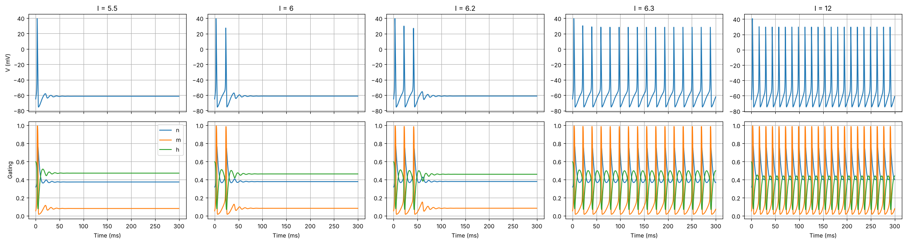
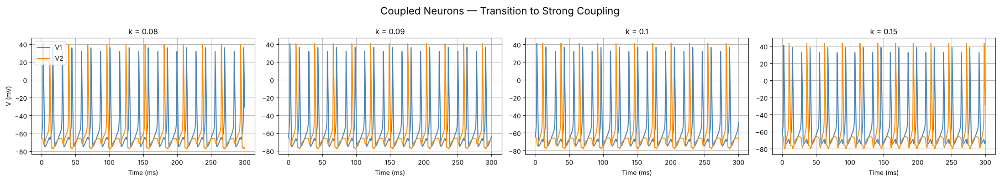

# Coupled Hodgkin–Huxley Neurons

**Numerical simulation of single and electrically coupled Hodgkin–Huxley neurons, with a comparison of explicit Euler, midpoint Runge–Kutta 2 and classical Runge–Kutta 4 integrators.**

Group project for *30561 Stochastic Processes and Simulation in Natural Sciences*, Bocconi University (December 2025) · Letizia Di Pietro, Benedicta Scarongella, Antonio Troiano

<p align="center">
  
</p>
<p align="center"><sub>Constant input currents from 5.5 to 12 µA/cm²: transient spikes up to 6.2, sustained firing from 6.3.</sub></p>

## Model

Each neuron follows the Hodgkin–Huxley equations

$$
C_m \frac{dV}{dt} = I_{\text{ext}} - \bar g_{Na}\, m^3 h\,(V - E_{Na}) - \bar g_{K}\, n^4 (V - E_K) - \bar g_L (V - E_L),
\qquad
\frac{dx}{dt} = \alpha_x(V)(1 - x) - \beta_x(V)\, x, \quad x \in \{m, h, n\},
$$

with the classical squid-axon parameters ($C_m = 1\ \mu\text{F/cm}^2$, $\bar g_{Na} = 120$, $\bar g_K = 36$, $\bar g_L = 0.3\ \text{mS/cm}^2$, $E_{Na} = 50$, $E_K = -77$, $E_L = -54.4\ \text{mV}$). Two neurons are coupled through a gap-junction-like term proportional to their voltage difference; only the first one receives an external current, so the second is driven entirely through the coupling.

## What the notebook covers

1. **Single neuron.** Response to no input, to a hyperpolarising current, to sub- and suprathreshold constant currents, and to a brief step current. The transition from transient to sustained firing lies between 6.2 and 6.3 µA/cm², and a near-threshold pulse lasting 10 ms produces exactly one spike.
2. **Two coupled neurons.** A sweep over the coupling strength $k \in [0, 0.15]$ with the first neuron driven at 10 µA/cm², followed by asymmetric couplings $(k_{12}, k_{21})$. Below $k \approx 0.08$ the second neuron shows only subthreshold oscillations; from $k \approx 0.08$ it is recruited into firing.
3. **Numerical integration.** Explicit Euler, midpoint Runge–Kutta 2 and classical Runge–Kutta 4 implemented from scratch, with run time measured over time steps from $10^{-4}$ to $10^{-1}$ ms. Run time scales as $1/\Delta t$ for all three; per step, RK2 costs about twice and RK4 about five times as much as Euler, the price of their higher order of accuracy.

<p align="center">
  
</p>

## A note on the coupling term

In the implementation (and in the equations written in the notebook) the coupling enters each neuron as $-k\,(V_j - V_i)$, which is the opposite sign of a passive gap junction, $+k\,(V_j - V_i)$. With the sign as implemented, a spike in the first neuron hyperpolarises the second, which then fires on the rebound: for $k$ between 0.08 and 0.15 the second neuron locks at **one spike for every two** of the first, roughly 8–9 ms later. This is what the coupling figures show. With the standard gap-junction sign, the same simulation gives **one-to-one** locking from $k = 0.10$, with a lag of about 3 ms that shrinks below 2 ms at $k = 0.15$: the synchronisation the project set out to study.

In the code the second neuron's input is weighted by `k[1, 0]`, i.e. $k_{21}$. This is why, in the asymmetric experiments, the second neuron fires whenever $k_{21} = 0.10$, whatever the value of $k_{12}$.

The notebook is published as submitted for the course (with comments translated to English and all cells re-executed in order); this section documents the issue rather than silently changing the results.

## Repository structure

```
.
├── hh_synchronization.ipynb   Model, simulations, coupling experiments and solver comparison
├── requirements.txt
└── assets/                    Figures used in this README
```

## Running the notebook

Only NumPy and Matplotlib are needed; the full notebook runs in about three minutes on a laptop.

```bash
pip install -r requirements.txt
jupyter notebook hh_synchronization.ipynb
```
